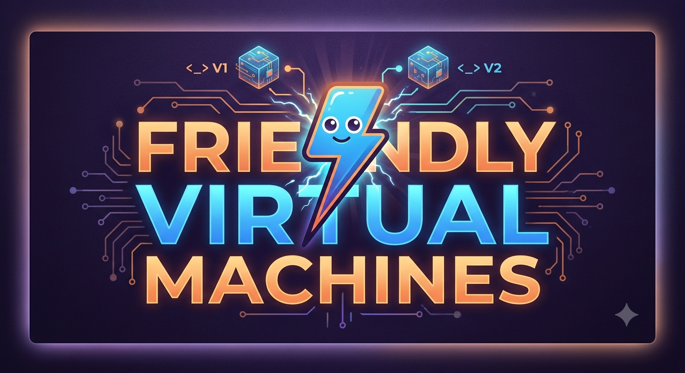

<div align="center">



### *A Curated Collection of Diverse, Ultra-Fast, Miniature Virtual Machines*

[](LICENSE)
[](https://www.rust-lang.org/)
[]()
[]()

*No 500,000-line production monoliths. No trivial 50-line toy calculators.*  
*Just clean, readable, bare-metal-inspired execution engines you can hold in your head at once.*

[Ontology](#-why-this-repository-exists) • [Design Philosophy](#-design-philosophy) • [Contributing](CONTRIBUTING.md)

</div>

---

## 🎯 Why This Repository Exists

When learning how virtual machines, instruction sets, and bytecode interpreters actually work under the hood, developers usually hit a wall between two extremes:

1. **The Toy Script:** A 50-line blog tutorial that evaluates `2 + 2` on a stack, missing registers, flags, memory addressing, and real control flow.
2. **The Industrial Monolith:** Massive runtimes like V8, QEMU, or the JVM, where core execution loops are buried beneath millions of lines of JIT compilers, garbage collectors, and legacy infrastructure.

**Friendly Virtual Machines** bridges that gap. Every VM in this repository is a self-contained, high-velocity execution engine engineered to stay **strictly under 7,000 lines of code**—complete with custom instruction sets, assemblers, and head-to-head native benchmarks.

---

## 🧠 Design Philosophy

* **📖 Readability First:** Every module is cleanly separated (CPU state, register file, ISA semantics, assembler, tests suite) with clear architectural comments so you can trace every cycle from text to execution.
* **⚡ Engineered for Velocity:** Built with zero-cost abstractions, inlined dispatch code, instruction dispatch loops, and deliberate low-level optimizations to minimize interpreter overhead.
* **📦 Zero External Bloat:** Pure standard library implementations. Clone, compile, and run offline in seconds with zero dependency trees.
* **📈 Evolutionary Progression:** Each sample builds upon the architectural lessons of the previous one—moving from foundational bytecode loops to full hardware-inspired register machines.
* **🪩 Diversity:** Each design showcases different implementations for a specific philosophy with benchmarks, optimizations & trade-offs.

---

## 🏛️ The Virtual Machines

> *Each VM lives in its own isolated crate/directory with dedicated benchmarks and documentation.*

Currently, the repo contains Rust & D samples:
- [Rust samples](rust_samples)
- [D samples](d_samples)
- [JS Samples](js_samples)

*(Check individual sample folders for detailed ISA tables and deep-dive architecture notes.)*

---

## 🎬 How to Run
Clone the repo into any preferred directory or name & navigate to it:
```shell
git clone https://github.com/Anantattva/Friendly-Virtual-Machines fvm && cd fvm
```

Now, navigate to any project folder you want. For example, let's navigate to `v5` of `register_based` of `rust_samples`.
```shell
cd rust_samples/register_based/v5
```

Now, just run via cargo:
```shell
cargo run --release
```

That's sit. That's all. Same for others.

For D, you might type:
```shell
dub run -b release
```

For JS:
```shell
node source.js
```

**Requirements:**
- A terminal & `git`.
- Rust toolchain: `rustc, cargo` & `llvm`.
- D toolchain: `dub` & `dmd/ldc2/gdc`.
- JS toolchain: `nodejs/deno/bun`.
